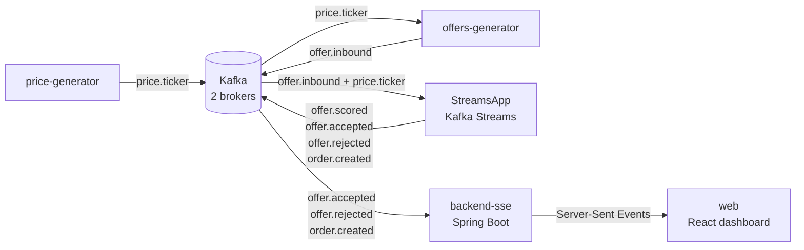

# Kafka Streams Offer Arena

> A real-time trading pipeline: simulated market prices and offers flow through **Apache Kafka**, get scored for profit by a **Kafka Streams** app with exactly-once processing, and stream live into a **React** dashboard via **Server-Sent Events**.


<!-- Placeholder: add a screenshot of the dashboard at docs/screenshot.png -->


---

## Features

- **Live market simulation** — a price generator publishes drifting prices for 4 SKUs; volatility increases after 30 seconds so the leaderboard keeps moving.
- **Price-aware offer generation** — an offer generator reads the latest prices and emits realistic BUY/SELL offers in random bursts.
- **Stream processing with Kafka Streams** — offers are re-keyed by SKU, joined with a price `KTable`, scored for profit and split into accepted / rejected streams.
- **Exactly-once semantics** (`exactly_once_v2`) and replication factor 2 across a **2-broker Kafka cluster**.
- **Best order per SKU** — a stateful reduce keeps the most profitable accepted offer per SKU and emits it as an order.
- **Real-time UI** — a Spring Boot gateway bridges Kafka topics to SSE; the React dashboard shows live tables and a game-style profit leaderboard.
- **One-command startup** with Docker Compose, plus **Kafdrop** to inspect topics.

## Architecture



### How scoring works

For each offer, the Streams app looks up the current market price `M` of its SKU:

| Side | Meaning | Profit per unit |
|------|---------|-----------------|
| `BUY`  | the counterparty buys from us | `P − (M + feesPct·P + shipping)` |
| `SELL` | we buy, then resell near market | `(M − feesPct·M − 3) − (P + 2)` |

- Total profit = profit per unit × `qty`, rounded to 2 decimals.
- Offers with **profit ≥ 3.0** go to `offer.accepted`; all others go to `offer.rejected`.
- Offers are scored against the latest known market price, so scoring starts once the price generator has published prices.
- The best accepted offer per SKU (highest profit) is published to `order.created`.

### Topics

| Topic | Partitions | Notes |
|-------|-----------:|-------|
| `price.ticker`   | 6  | compacted, latest price per SKU |
| `offer.inbound`  | 12 | raw generated offers |
| `offer.scored`   | 12 | every offer with market price, profit and reason |
| `offer.accepted` | 12 | profit ≥ 3.0 |
| `offer.rejected` | 12 | profit < 3.0 |
| `order.created`  | 6  | best accepted offer per SKU |
| `policy.config`  | 1  | compacted, reserved for dynamic policy (not used yet) |

All topics use replication factor 2 and are created automatically by the `create-topics` container.

## Prerequisites

- [Docker Desktop](https://www.docker.com/products/docker-desktop/) (Windows or macOS) with Docker Compose v2
- Optional, for running components outside Docker: JDK 17, Maven 3.9+, Node.js 18+

## Quick start

```bash
git clone https://github.com/iheb-kh/kafka-treams-offer.git
cd kafka-treams-offer/docker
docker compose up --build
```

The first build takes a few minutes. Once everything is up:

| Service | URL | Description |
|---------|-----|-------------|
| Dashboard | http://localhost:3000 | Live Offer Arena (React) |
| SSE API | http://localhost:8088/sse/accepted · `/sse/rejected` · `/sse/orders` | Event streams consumed by the UI |
| Kafdrop | http://localhost:9000 | Browse topics and messages |

Stop everything with `docker compose down`.

## Running components locally

Useful while developing a single component from your IDE.

1. **Start Kafka only:** `docker compose -f docker/docker-compose.yml up zookeeper kafka1 kafka2 kafdrop create-topics`
   (`scripts/create-topics.sh` can also (re)create the topics in a running `kafka1` container.)
2. **Make the advertised broker address resolvable** from your machine by adding this line to your hosts file:
   `127.0.0.1 host.docker.internal`
3. **Run the Java apps** (they default to `localhost:9092`; override with `KAFKA_BOOTSTRAP_SERVERS`):
   ```bash
   cd streams-app
   mvn package
   java -cp target/streams-app-1.0.0.jar app.pricegenerator.PriceGenerator
   java -cp target/streams-app-1.0.0.jar app.offergenerator.OffersGenerator
   java -cp target/streams-app-1.0.0.jar app.streams.StreamsApp
   ```
4. **Run the SSE backend:** `cd backend-sse && ./mvnw spring-boot:run` (port 8088)
5. **Run the dashboard:** `cd web && npm install && npm run dev` (http://localhost:5173)

`docker/docker-compose.infra.yml` is an alternative Kafka-only stack on a dedicated network, with brokers advertised as `kafka1`/`kafka2`.

## Project structure

```
.
├── streams-app/                 # Plain Java (Kafka clients + Kafka Streams)
│   └── src/main/java/app/
│       ├── config/              # Shared Kafka producer/consumer settings
│       ├── pricegenerator/      # Publishes market prices → price.ticker
│       ├── offergenerator/      # Publishes offers → offer.inbound
│       └── streams/             # Scoring topology (join, branch, reduce)
├── backend-sse/                 # Spring Boot gateway: Kafka → Server-Sent Events
│   └── src/main/java/org/example/backendsse/
│       ├── controller/          # /sse/* endpoints
│       └── service/             # Kafka listeners + SSE broadcasting
├── web/                         # React + Vite dashboard (served by nginx in Docker)
├── docker/
│   ├── docker-compose.yml       # Full stack
│   └── docker-compose.infra.yml # Kafka-only stack
├── scripts/create-topics.sh     # Manual topic creation
└── docs/                        # Screenshots
```

## Known limitations

- **Docker Desktop networking:** brokers advertise `host.docker.internal`, which resolves out of the box on Docker Desktop (Windows/macOS) but not on plain Linux Docker Engine.
- **Static policy:** the minimum profit (3.0) and shipping costs are hardcoded; the `policy.config` topic is created but not consumed yet.
- **Fixed backend URL:** the dashboard connects to `http://localhost:8088`.
- **Demo scope:** simulated data, no authentication, and no automated tests beyond the Spring context test.

## Roadmap

- [ ] Drive the scoring policy dynamically from `policy.config`
- [ ] Separate internal/external Kafka listeners so the stack runs on any Docker host
- [ ] Unit tests for the scoring topology (`TopologyTestDriver`) and a CI pipeline
- [ ] Configurable backend URL for the dashboard

## Contributing

Contributions are welcome — see [CONTRIBUTING.md](CONTRIBUTING.md).

## License

Released under the [MIT License](LICENSE).
